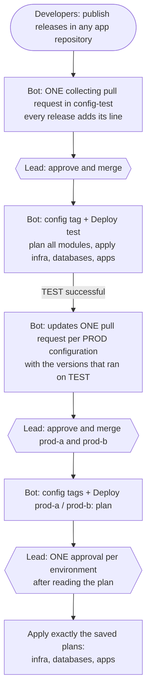

# Release PoC: one release, everything else follows

Proof of concept for a release flow where **developers only publish releases** and the **lead only approves**. Pull requests, configuration tags, deployments, the promotion from TEST to PROD and the forward-port of fixes are done by a release bot (a GitHub App). Nothing here touches a real system: Terraform manages simulated resources (`terraform_data`).

## Stages and branches

```
feature/*  ── PR ──┐
bugfix/*   ── PR ──┼── main (protected: PR + required check "ci / quality-gates" + CODEOWNERS)
hotfix/*   ── PR ──┘          │
                              ▼
                   Quality gates (shell lint, Dockerfile lint, tests, secret scan, build)
                              │
                              ▼
                   Build the image ONCE (ghcr.io, digest sha256:...)
                              │
                              ▼
                   DEV   every merge to main, previews of branches
                              │   publish release/x.y.z (retag, same digest)
                              ▼
                   TEST  (staging) collecting pull request, release candidates
                              │   promote pull requests, same versions and digests
                              ▼
                   Release approval (one per environment, after the plan)
                              │
                              ▼
                   PROD  prod-a, prod-b
```

## Many repositories, one way of working

| Problem | In this PoC |
|---|---|
| every app repository copies its own pipeline | thin callers (`ci.yml`, `release.yml`, `branches.yml`, about 15 lines each) use the central workflows `app-ci.yml`, `app-release.yml`, `app-branches.yml` of this repository, pinned to a tag |
| a pipeline change must reach all repositories | publishing a new tag here starts **Roll out templates**: the bot opens one pull request per app repository; its quality gates run with the new version before the merge |
| repositories drift apart (settings, checks, branch names) | **Baseline check** reads every app repository and shows one table: pull request required, required check, CODEOWNERS, template version, release branch names |
| ten apps released on the same day | one collecting pull request in config-test, one TEST run, one promote pull request per PROD site |
| which apps exist | `apps/apps.yaml`: one entry per app repository |

## The repositories

| Repository | What it holds |
|---|---|
| [release-poc-app](https://github.com/christianlehnert/release-poc-app) | an application with `main` and release branches `releases/x.y`. A published release starts the flow. Also simulates the releases of other apps |
| [release-poc-ui](https://github.com/christianlehnert/release-poc-ui), [release-poc-worker](https://github.com/christianlehnert/release-poc-worker) | two more applications with the same thin callers |
| [release-poc-config-dev](https://github.com/christianlehnert/release-poc-config-dev) | configuration of DEV: updated directly by the bot after every merge to main |
| [release-poc-config-test](https://github.com/christianlehnert/release-poc-config-test) | configuration of TEST: `terraform/versions.tfvars` (versions), `terraform/features.tfvars` (feature flags) |
| [release-poc-config-prod-a](https://github.com/christianlehnert/release-poc-config-prod-a) | configuration of PROD, active site |
| [release-poc-config-prod-b](https://github.com/christianlehnert/release-poc-config-prod-b) | configuration of PROD, standby site (no database migrations, no health check) |
| release-poc-deployment (this one) | pipeline `Deploy`, central app workflows, `Roll out templates`, `Baseline check`, `apps/apps.yaml`, scripts, Terraform modules `infra`, `databases`, `apps` |

## The flow



| Who | Does what |
|---|---|
| Developers | publish releases. That is all |
| Lead | merges 3 pull requests (test, prod-a, prod-b) and gives 2 approvals (prod-a, prod-b), however many apps are in the release |
| Release bot | collecting pull request, configuration tags, runs with the newest pipeline tag, promotion TEST to PROD, forward-port of fixes from release branches to main |

## Full deployment

One run deploys everything that changed: the plan job plans the modules `infra`, `databases` and `apps` (each with its own state) and shows a table *create / update / replace / delete* per module. The apply job waits for **one** approval and then applies the saved plans in this order. A new application only needs a new line `<name>_tag = "release/x.y.z"` in `versions.tfvars`.

## Release branches and features that must not go to PROD yet

- **Release branch:** fixes for PROD go into `releases/x.y` and are released from there. The workflow *Forward-port to main* cherry-picks them onto `main` and opens the pull request by itself (draft with the file names if there is a conflict).
- **Long-running scope** (months without PROD): develop on `scope/<name>`. Every push deploys a **preview** to DEV (`preview/<branch>-<commit>`, only allowed on dev, never promoted). Every push to `main` makes the bot open a pull request that merges `main` into each `scope/**` branch, so the scope keeps the PROD fixes. Chain: `releases/x.y` → `main` → `scope/*`.
- **Feature flags:** `features.tfvars` lives in every configuration repository and is **not** promoted. A feature can be on in TEST and off in PROD with the same application version.

## Rollback

Run **Deploy** by hand: Use workflow from = the pipeline tag of back then, environment, `config_tag` = the previous configuration tag (`state/<environment>/config_tag` in the branch `deploy-state`). Then set `main` of the configuration repository back with a pull request, so the next tag does not bring the broken version again. If you start the run yourself, someone else must approve it.

## What runs where

- The branch `deploy-state` stands in for the real infrastructure: per environment and module the Terraform state, plus the applied versions, feature flags and configuration tag.
- The bot needs the variable `RELEASE_BOT_CLIENT_ID` and the secret `RELEASE_BOT_PRIVATE_KEY` in every repository that uses it.
