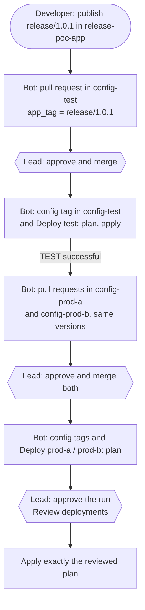

# Release PoC: one release, everything else follows

Proof of concept for a release flow where a **developer only creates one release** and the **lead only approves**. Pull requests, configuration tags, deployments and the promotion from TEST to PROD are done by a release bot (a GitHub App). Nothing here touches a real system: Terraform manages simulated resources (`terraform_data`).

## The repositories

| Repository | What it holds |
|---|---|
| [release-poc-app](https://github.com/christianlehnert/release-poc-app) | a fake application. Publishing a release starts the flow |
| [release-poc-config-test](https://github.com/christianlehnert/release-poc-config-test) | configuration of TEST: `terraform/versions.tfvars` |
| [release-poc-config-prod-a](https://github.com/christianlehnert/release-poc-config-prod-a) | configuration of PROD (active site) |
| [release-poc-config-prod-b](https://github.com/christianlehnert/release-poc-config-prod-b) | configuration of PROD (standby site) |
| release-poc-deployment (this one) | the pipeline `Deploy` and the Terraform code |

## The flow

| Who | Does what |
|---|---|
| Developer | publishes the release in the app repository. That is all |
| Lead | approves 3 pull requests (test, prod-a, prod-b) and 2 PROD runs |
| Release bot | opens the pull requests, creates the configuration tags, starts the runs with the newest pipeline tag, promotes TEST to PROD |

## What this shows compared with a manual flow

| Topic | Manual | Here |
|---|---|---|
| App version | typed by hand into versions.tfvars of 3 repositories | written by the bot, from the release that was published |
| Configuration tag | created by hand, easy to forget | created by the bot after every merge |
| Use workflow from | chosen by hand, `main` possible | bot uses the newest pipeline tag; PROD refuses a branch |
| Same versions in PROD as in TEST | copied by hand | the bot copies the versions.tfvars that ran on TEST |
| Plan and apply | two runs with the same values; apply plans again | one run; apply uses the saved plan, Terraform refuses a stale plan |
| Four eyes | the author of a pull request cannot approve it | the same, plus CODEOWNERS: the lead must approve, also pull requests of the bot |
| PROD approval | the starter cannot approve | the bot starts, the lead approves; environments prod-a and prod-b only accept tags release/* |

## Rollback

Run **Deploy** by hand: Use workflow from = the pipeline tag of back then, environment, `config_tag` = the previous configuration tag (see `state/<environment>.config_tag` in the branch `deploy-state`). Then set `main` of the configuration repository back with a pull request, so the next tag does not bring the broken version again.

## What runs where

- The branch `deploy-state` stands in for the real infrastructure: per environment the Terraform state, the applied versions and the configuration tag.
- The bot needs the variable `RELEASE_BOT_APP_ID` and the secret `RELEASE_BOT_PRIVATE_KEY` in every repository that uses it.
